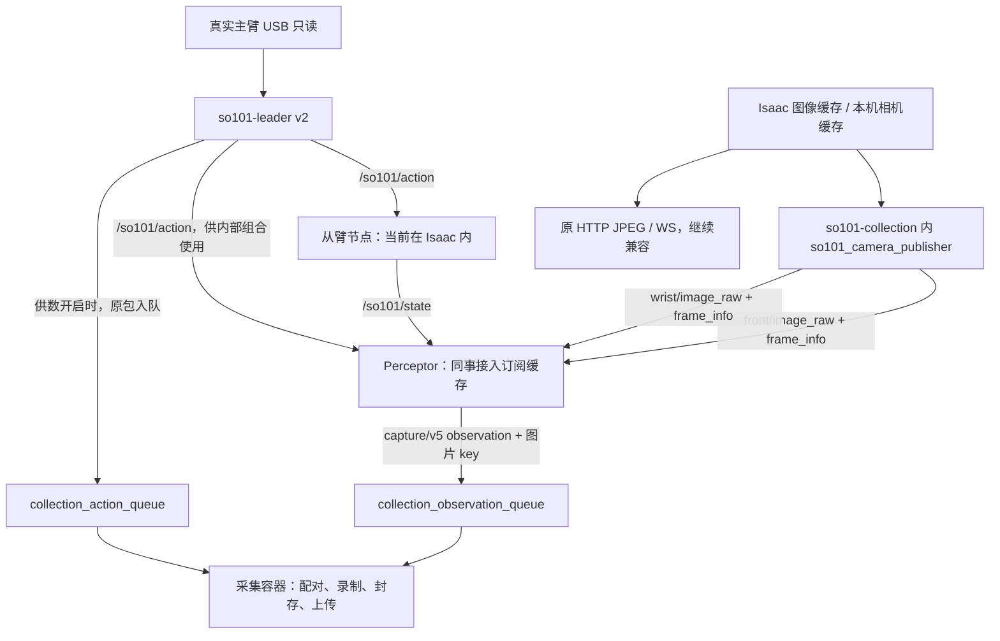

# SO101 → Perceptor：关节、前方/腕部图像与 action 的 ROS 接入（v10r16）

日期：2026-11-05（America/Los_Angeles）。当前镜像 `so101-collection:20261105-v10r16`，已在 Spark `192.168.0.215` 上线。

**前方和腕部的 ROS 图像发布现已补齐，由我们的采集容器提供；原 HTTP/JPEG/WS 接口继续可用。** 同事现在可以订阅关节、图像、action 后接回既有 observation 组包流程，不需要等待其他方提供 SO101 图像 Topic。

本轮只修改采集容器。Perceptor、主臂节点、从臂节点和 Isaac 均未修改或重启；Perceptor 当前仍使用原 ARM_INSPECT / HTTP 消费方式，消费端改成订阅需由接入同事实施。

## 1. 数据线路



图像发布直接读取原有源缓存，**不读取 Perceptor 回写的 Redis 观测图像来作为发布源**，避免“等观测才能发布图像、等图像才能组观测”的循环。真实摄像头仍只有原 camera_service 打开设备；新增发布进程不打开 USB、不读写机械臂。

## 2. Topic、消息和 QoS

全部使用 **ROS_DOMAIN_ID=96**。Topic 是下面的绝对名称，无需添加节点 namespace。

| 数据 | Topic | ROS 类型 | 发布端 QoS |
|---|---|---|---|
| 从臂实测状态 | `/so101/state` | `std_msgs/msg/String`，JSON | RELIABLE / VOLATILE / KEEP_LAST 16 |
| 主臂 action | `/so101/action` | `std_msgs/msg/String`，JSON | RELIABLE / VOLATILE / KEEP_LAST 10 |
| 前方 RGB 图像 | `/so101/camera/front/image_raw` | `sensor_msgs/msg/Image` | RELIABLE / VOLATILE / KEEP_LAST 2 |
| 腕部 RGB 图像 | `/so101/camera/wrist/image_raw` | `sensor_msgs/msg/Image` | RELIABLE / VOLATILE / KEEP_LAST 2 |
| 前方帧来源与时间信息 | `/so101/camera/front/frame_info` | `std_msgs/msg/String`，JSON | RELIABLE / VOLATILE / KEEP_LAST 2 |
| 腕部帧来源与时间信息 | `/so101/camera/wrist/frame_info` | `std_msgs/msg/String`，JSON | RELIABLE / VOLATILE / KEEP_LAST 2 |

新图像发布节点名为 `so101_camera_publisher`，运行在 **so101-collection** 内，不是新增常驻容器。状态仍由从臂节点发布，action 仍由主臂节点发布。

订阅图像可用 RELIABLE、VOLATILE、depth=2；状态/action 可用 depth=16。当前同机 Docker 使用 host 网络，ROS 2 Jazzy / Fast DDS。已有 Node 在 Domain96 时直接增加订阅，不要重复初始化 context。

```bash
source /opt/ros/jazzy/setup.bash
export ROS_DOMAIN_ID=96
export RMW_IMPLEMENTATION=rmw_fastrtps_cpp
export FASTDDS_BUILTIN_TRANSPORTS=UDPv4
export ROS_AUTOMATIC_DISCOVERY_RANGE=SUBNET
unset ROS_LOCALHOST_ONLY
```

旧采集内部 Domain173 与本次相机发布环境隔离；不要用 173 订阅这些相机 Topic。

## 3. sensor_msgs/Image 的内容

每条消息是一张原始 RGB 图像，不是 JPEG、PNG、视频包、URL 或 WebRTC 信令。当前现场消息字段为：

```text
header.stamp.sec / nanosec = 源帧已有 captured_unix_ns 拆分出的秒与纳秒
header.frame_id           = so101_front_optical_frame / so101_wrist_optical_frame
height                    = 480
width                     = 640
encoding                  = rgb8
is_bigendian              = 0
step                      = 1920（width × 3，每行字节数）
data                      = 921600 字节（height × step）
```

`header.frame_id` 是稳定的相机坐标系名称，不是唯一帧编号，也不表示本轮发布了 TF/相机标定。唯一来源帧身份在配套 `frame_info.frame.frame_id` 中。

图像保持源帧 RGB 像素，不经过 JPEG 再解码来生成 ROS 数据。仿真从原有 PNG 缓存解码 RGB；真相机从已有无损 RGB 共享缓存读取。已有 HTTP 路线仍使用原来的 JPEG 编码输出。

可以用 `cv_bridge.imgmsg_to_cv2(msg, desired_encoding="rgb8")`；如果既有适配器需要 BGR，显式请求 `bgr8`。不要仅修改 encoding 标签而不转换像素。

## 4. 时间戳和原始帧来源

新增层不做帧龄、未来值、时差或单调性拒绝；源读取器原有的检查保留，也没有改写 Perceptor 原有检查。

| 字段 | 时间基准及含义 |
|---|---|
| `Image.header.stamp` | **Unix 时间**，来自源帧已有 `captured_unix_ns`，不是 ROS 发布时刻、接收时刻或 Isaac `/clock` 仿真秒 |
| `frame_info.captured_unix_ns` | 同一 Unix 纳秒整数，与 Image 头完全对应 |
| `frame_info.frame.captured_monotonic_ns` | 源帧已有主机 monotonic 纳秒；当前同机时可与关节状态采样时刻比较 |
| `frame_info.frame.received_monotonic_ns` | 我方图像发布进程读取源帧时的 monotonic 纳秒，不是 Perceptor 收到 DDS 消息的时刻 |
| `frame_info.frame.source` | 源类型、sequence、generation、原始时间和源 metadata，保留原值 |
| 同事回调里的 `time.monotonic_ns()` | Perceptor 本地接收时刻，建议另记；不能替代原始采集时刻 |

这些是现有软件采集/渲染记录的时刻，不宣称是相机硬件曝光时刻或硬件同步结果。相同源帧不会反复发布；去重使用来源、generation、sequence 和已有采样时刻，不根据时间是否递增来拒绝新帧，也不把旧时间“修正”为现在。

### 4.1 frame_info

完整现场样本见 [v10r16 实测消息和验收数据](so101-ros-images-v10r16-acceptance-20261105.json)。关键结构为：

```json
{
  "schema": "so101.ros.camera-frame.v1",
  "camera_key": "front",
  "image_topic": "/so101/camera/front/image_raw",
  "ros_header": {
    "frame_id": "so101_front_optical_frame",
    "stamp": {"sec": 1793900000, "nanosec": 123456789}
  },
  "stamp_time_basis": "unix",
  "captured_unix_ns": 1793900000123456789,
  "rgb_sha256": "对应RGB字节的SHA256，64位小写十六进制，不带前缀",
  "frame": {
    "schema": "collection.frame.v1",
    "camera_key": "front",
    "frame_id": "frame-来源身份摘要",
    "encoding": "rgb8",
    "dtype": "uint8",
    "width": 640,
    "height": 480,
    "captured_monotonic_ns": 1462812353971016,
    "received_monotonic_ns": 1462812360000000,
    "source": {
      "kind": "isaac_preview",
      "process_id": "sim:当前generation",
      "generation": "当前generation",
      "sequence": 123,
      "captured_unix_ns": 1793900000123456789,
      "time_basis": "host_monotonic",
      "original_metadata": "完整原始metadata对象；此处省略"
    }
  }
}
```

上例用于字段说明，里面的示例时间和身份不要写死。实际 `original_metadata` 是 JSON 对象，具体帧信息由源缓存提供。

图像与元数据是不同 Topic，不承诺回调顺序或原子成对。需要关联时可用相机名、header stamp 及 RGB hash；同时保留源 sequence / generation / frame_id。遇到重复源时间戳，不改写时间、不新增硬拒绝规则，也不能仅凭一个时间值宣称一一关联。

## 5. 同事接收两路图像的代码片段

以下可接到已有 Node。`on_frame` 和 `on_info` 是同事接入原相机/观测适配器的回调，不负责直接写 observation 队列；已有 executor 需要持续 spin。

```python
import json
import time
import numpy as np
from sensor_msgs.msg import Image
from std_msgs.msg import String
from rclpy.qos import QoSProfile, ReliabilityPolicy, DurabilityPolicy, HistoryPolicy

def subscribe_so101_images(node, on_frame, on_info):
    qos = QoSProfile(depth=2,
        reliability=ReliabilityPolicy.RELIABLE,
        durability=DurabilityPolicy.VOLATILE,
        history=HistoryPolicy.KEEP_LAST)

    def image_callback(camera, msg):
        if msg.encoding != "rgb8":
            raise ValueError("Expected SO101 rgb8 image")
        rows = np.frombuffer(msg.data, dtype=np.uint8).reshape(msg.height, msg.step)
        rgb = rows[:, :msg.width * 3].reshape(msg.height, msg.width, 3).copy()
        unix_ns = msg.header.stamp.sec * 1_000_000_000 + msg.header.stamp.nanosec
        on_frame(camera, rgb, {
            "captured_unix_ns": unix_ns,
            "received_monotonic_ns": time.monotonic_ns(),
            "optical_frame": msg.header.frame_id,
        })

    subscriptions = []
    for camera in ("front", "wrist"):
        subscriptions.append(node.create_subscription(
            Image, f"/so101/camera/{camera}/image_raw",
            lambda msg, c=camera: image_callback(c, msg), qos))
        subscriptions.append(node.create_subscription(
            String, f"/so101/camera/{camera}/frame_info",
            lambda msg, c=camera: on_info(c, json.loads(msg.data)), qos))
    return subscriptions  # 在组件中保存，关闭组件时销毁订阅
```

回调只做取帧/缓存，不在 ROS executor 中等待其他相机、关节或 action。实际接入沿用项目的解析异常日志和生命周期管理。

### 5.1 接回现有相机帧接口

- 相机名保持 `front / wrist`，当前每路 `uint8[480,640,3]`、`rgb8`。
- 将 RGB 帧交给原有 RawFramePacket / `offer_native_camera` 流程；框架继续保存图像字节到 Redis，observation 中仍是图片 key。
- 原始 `header.stamp` 可以记录为 RawFramePacket 的源 timestamp（Unix 秒），不能直接把它当成 `sources.front.sampled_at` 的 monotonic 秒。
- 当前同机若已关联 frame_info，可以使用 `frame_info.frame.captured_monotonic_ns / 1e9` 作为相机源 sampled_at。只收到 Image 时，保留源 Unix 时间、另记接收 monotonic，并如实使用既有 `receive_approx` 语义；不要伪称已取得原始 monotonic。
- 原始字段是否进入最终数据集，仍取决于同事现有适配器/钩子的透传；新增这两个 Topic 不会自动修改 Perceptor 代码。完整 ROS 来源 ID 的额外透传不能仅靠改一个 profile 注释实现。

## 6. 关节状态和主臂 action 怎么一起接

这两路格式未改变，完整字段和现有 Perceptor 钩子接法见 [上一版状态/action 接入说明](SO101-Perceptor观测与主臂Action-ROS订阅接入说明-20261104.md)；其中“没有图像 Topic”的描述属于 v15r1 历史状态，当前图像接法以本文为准。

| 内容 | 接入方法 |
|---|---|
| 从臂实测状态 | 解析 `/so101/state` JSON：`params.result.native.joints[].position`，复用既有 encoder_mapping/normalize_inspection 将 ticks 换成前五轴 deg、夹爪 0～100 |
| 状态源时刻 | `native.sampled_mono_ns / 1e9`；保留 session_id / sample_seq；不要把缓存读取时间当作新采样时刻 |
| 主臂 action | `/so101/action` 是 teleop/action/v1，positions 已是 deg / 夹爪百分比，bare 六轴名，无需再次 ticks 换算 |
| 主臂 action 时刻 | `timestamp` 已是 CLOCK_MONOTONIC 秒，保留 process_id、seq、action_id；input_observation_id 当前为 null，不伪造观测因果 ID |

同事内部可以组合：

```text
sample.observation.state     从臂实测六轴
sample.observation.images    front / wrist 图像帧
sample.action                已按现有规则配对的主臂目标
sample.source_times          各来源的原始时间、接收时间及时间基准
```

不要把 action 拼成 state 的第 7～12 维。当前采集容器仍会从两个 Redis 队列配对：选 `action.timestamp >= sources.arm_state.sampled_at` 的第一条，最大相差 0.1 秒；不等于随手取最新 action。此规则本轮没有改变。

**主臂节点已经负责把 teleop/action/v1 原包写入 `collection_action_queue`，Perceptor 订阅后不要再 LPUSH 同一份动作，也不要 BRPOP 抢走采集容器的数据。** 观测队列仍由 Perceptor 组包，采集容器在开始/结束时管理 `collection_enabled`。

Composer → DM → Perceptor 七个原动作仍是高层 command_request，不会自动产生 `/so101/action` 的逐帧执行标签；当前 `/so101/action` 是主臂示教意图。不要将两种控制源混采，或将 `goal` / 动作成功回执直接当作完整逐帧执行 action。

## 7. HTTP 兼容与容器配置

以下入口完全保留，无需前端改动：

```text
http://192.168.0.215:8910/collection/video
http://192.168.0.215:8910/collection/video/front.jpg
http://192.168.0.215:8910/collection/video/wrist.jpg
ws://192.168.0.215:8910/collection/video/ws?camera=front&fps=10
ws://192.168.0.215:8910/collection/video/ws?camera=wrist&fps=10
```

采集的 start / redo / complete / finish / abandon 及认证方式不变，继续按 [REST 最小接入指南](SO101采集容器REST最小接入指南-20261104-v10r15r1.md) 调用。开始、结束采集不负责停止独立从臂节点的跟随。

新增可选部署配置（不是 REST 参数）：

```dotenv
COLLECTION_ROS_IMAGES_ENABLED=1
COLLECTION_ROS_IMAGES_DOMAIN_ID=96
COLLECTION_ROS_IMAGES_RATE_HZ=10
```

频率是发布上限，范围 `(0,30]`；只发布不同的源帧，不保证达到设定值，也不改变录制 fps。只对 `COLLECTION_ROBOT=so101-sim / so101` 启动；Bobac 不在此处重新发布一份 SO101 画面。配置改动在重建该采集容器后生效，勿在录制中重启。

当前源/Compose：

```text
/home/nvidia/lerobot-so101-sdk/collection-container-v10r16-20261105/
```

统一入口 `collection-current/` 已指向该版本；v15r1 源码/镜像保留回退。数据、配置、密钥和交付目录继续使用原持久化挂载。

## 8. 已完成的验证与同事下一步

| 验证 | 结果 |
|---|---|
| Spark 镜像相关回归 | 29 项通过：新增图像输出 + 原 HTTP 视频 + 采集 HTTP 状态接口 |
| 隔离 Domain197 原生 ROS 测试 | 两路像素精确一致，源时间戳透传；旧 Unix 时间戳也原样发出，发布进程正常退出 |
| Domain96 独立容器订阅现场图像 | 前方 39 帧、腕部 39 帧，均为 640×480 rgb8；78 份图像与元数据按头和 RGB hash 匹配 |
| 同时读取状态/action | 10 秒探针收到 50 条状态、301 条 action |
| HTTP JPEG / WS | 两路 JPEG 都 200，各 WS 实收 2 帧 |
| 采集上传并发复测 | start → redo → complete → finish → 2 条 / 17 帧 → 原生 LeRobot 校验 → 远端 READY；废弃轮次排除，远端文件内容一致 |
| 其他服务 | Perceptor 文件 hash、主臂、从臂/Isaac 等其他运行容器身份及启动时间未变 |

现场验证的是 Isaac 仿真；真相机源通过已有 RGB 缓存的软件测试覆盖，本轮没有接入物理相机或驱动真实从臂。图像发布和现有采集并行已验，但 **Perceptor 消费端迁移仍未实施**：现有完整采集复测仍沿用其 ARM_INSPECT / HTTP 入口，不能把它当作同事新订阅代码已验收。

同事接入后应确认：Perceptor 出现在三个数据来源的订阅图中，周期取数不再发 ARM_INSPECT、相机不再依赖 HTTP；转换后的六轴/图像/时间信息仍符合 capture/v5；主臂动作没有重复入队；再用新批次完成一次重采、换条、封存上传验收。

图像原始时间、映射时刻和接收时间分开保存，先不扩展时间戳校验。跨主机时不能直接比较不同主机的 monotonic；如后续搬迁 Perceptor，需要另定义时钟映射，不能用 Unix 对时冒充 monotonic 已一致。
