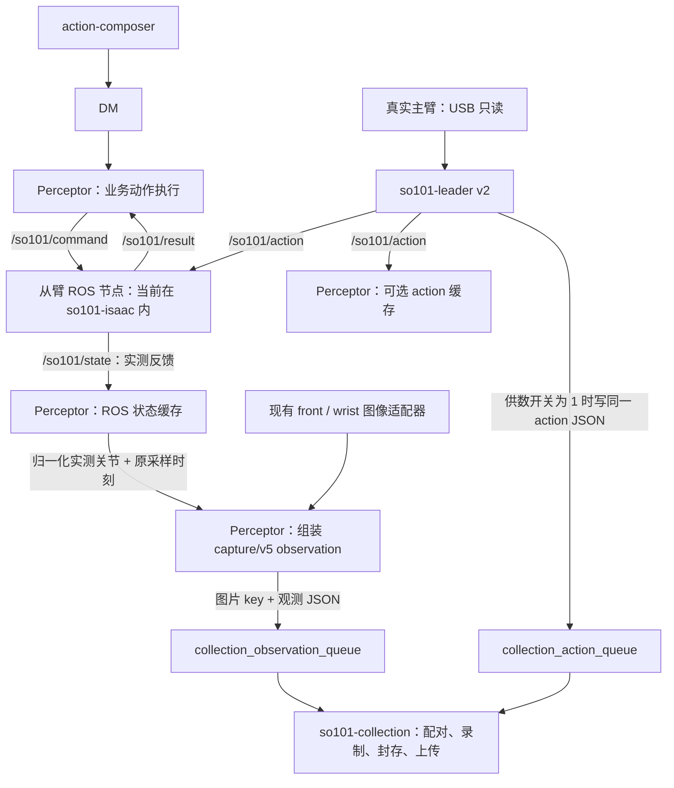

# SO101 → Perceptor：观测与主臂 action 的 ROS 订阅接入说明

日期：2026-11-04（America/Los_Angeles）。适用采集版本：v10r15r1；主臂节点：`so101-leader:20261104-v2`；当前仿真从臂节点在 `so101-isaac` 内。

本文供 action-composer / DM / Perceptor 接入同事使用，说明采集取数从 ARM_INSPECT 请求改为 ROS 订阅的方法。**状态推送端已经上线，Perceptor 消费端尚未改为订阅。** 本次只核对接口、实测订阅和提供接入文档，没有修改 Perceptor。

## 1. 要改什么

| 数据 | 旧方式 | 接入后 |
|---|---|---|
| 从臂实测电机状态 | Perceptor 的 `fetch_data()` 调用 `ARM_INSPECT` 并等待回执 | 订阅 `/so101/state`，缓存最新快照；`fetch_data()` 从缓存取数 |
| 主臂示教 action | 以前由采集/控制耦合链路取得 | 独立主臂节点发布 `/so101/action`；Perceptor 需要时订阅并缓存 |
| 前方/腕部图像 | Perceptor 现有相机适配器获取图像帧 | 保留现有链路；这两个 ROS Topic **不携带图像** |
| 观测入队 | Perceptor 组装 `capture/v5`，写 observation 队列和图片 key | 格式保持不变；将状态源换成 ROS 缓存 |
| action 入队 | 当前主臂 v2 已负责 | **仍由主臂节点负责，不要在 Perceptor 再写一份相同动作** |

`ARM_INSPECT` 仍可用于手动诊断，但不再作为迁移后的周期采样入口。Composer → DM → Perceptor 的业务命令线路不因本次取数方式变化而改变。

## 2. 两条数据线路及职责



Perceptor 可以订阅两路，统一提供其内部的“观测 + action”视图；**从臂实测状态进入 observation.state，主臂指令进入独立的 action 槽位。** 六维 state 的长度、关节顺序和含义不变。不要用主臂位置覆盖从臂实测值，也不要把 action 再拼成 observation.state 的第 7～12 维。

当前采集容器从两个 Redis 队列自行完成 observation/action 配对。因此，仅完成状态订阅迁移，就可以继续使用已有采集格式；不要求把主臂 action 再塞进 `capture/v5.state`。

## 3. ROS 连接参数

当前三个节点及 Perceptor 位于同一台 Spark：`192.168.0.215`。

| 项目 | 从臂状态 | 主臂 action |
|---|---|---|
| Topic | `/so101/state` | `/so101/action` |
| ROS 类型 | `std_msgs/msg/String` | `std_msgs/msg/String` |
| 字符串内容 | JSON，`action=ARM_STATE` | JSON，`schema_version=teleop/action/v1` |
| ROS Domain | 96 | 96 |
| 当前发布节点 | `/so101_follower_sim/seeed_follower_actions` | `/so101_leader` |
| 当前发布容器 | `so101-isaac` | `so101-leader` |
| 发布 QoS | RELIABLE、VOLATILE、KEEP_LAST 16 | RELIABLE、VOLATILE、KEEP_LAST 10 |
| 默认发布频率 | 仿真约 5 Hz；新真机节点默认约 2 Hz | 30 Hz，可配置 |
| 本次实测 | 4.98 Hz | 30.58 Hz |

订阅方可以统一使用 RELIABLE、VOLATILE、KEEP_LAST 16，兼容这两路发布端。Topic 是绝对名称，**不用加上 `/so101_follower_sim` 前缀**。不要沿用旧主臂指南里的 `/so101/leader`，v2 当前发布的是 `/so101/action`。

Docker 场景下使用现有 ROS/DDS 网络配置；当前同机部署使用 host 网络。核对环境：

```bash
source /opt/ros/jazzy/setup.bash
export ROS_DOMAIN_ID=96
export RMW_IMPLEMENTATION=rmw_fastrtps_cpp
export FASTDDS_BUILTIN_TRANSPORTS=UDPv4
export ROS_AUTOMATIC_DISCOVERY_RANGE=SUBNET
unset ROS_LOCALHOST_ONLY
```

不要拿采集容器历史内部配置中的其他 Domain 值作为这两个 Topic 的 Domain。Perceptor 如果已有同 Domain 的 ROS Node，直接在该 Node 上增加订阅，不要重复初始化 ROS context。

## 4. 从臂实测状态：替换 ARM_INSPECT 的取数入口

ROS 消息的解析路径：

```python
packet = json.loads(msg.data)
assert packet["action"] == "ARM_STATE"
raw = packet["params"]["result"]
native = raw["native"]
```

这里的 `raw` 与过去 `ARM_INSPECT` 回执里的 `params.result` 形状一致，可以复用现有 `normalize_inspection(raw)`。**观测使用 `native.joints[*].position`，不能使用 `goal`。**

采集相关字段示例（省略其他控制状态；完整实测消息见 [ROS 消息样本](so101-ros-topic-samples-20261104.json)）：

```json
{
  "action": "ARM_STATE",
  "params": {
    "status": "SUCCEEDED",
    "result": {
      "robot_id": "so101-follower-isaac",
      "device_id": "isaac:so101-isaac-console",
      "native": {
        "connected": true,
        "session_id": "5c9424e0cac14d2e9d8275c0d4d458f4",
        "profile_id": "isaac-so101-console",
        "fault": null,
        "feedback_fresh": true,
        "feedback_age_s": 0.0,
        "sample_seq": 57179,
        "sampled_mono_ns": 1462812353971016,
        "sampled_unix": 1793861367.041891,
        "source": {"kind": "isaac_sample", "time_ns": 1462812305667502},
        "joints": [
          {"id": 1, "name": "shoulder_pan", "position": 2200, "goal": 2200},
          {"id": 2, "name": "shoulder_lift", "position": 944, "goal": 899},
          {"id": 3, "name": "elbow_flex", "position": 3060, "goal": 3148},
          {"id": 4, "name": "wrist_flex", "position": 2892, "goal": 2891},
          {"id": 5, "name": "wrist_roll", "position": 3150, "goal": 3151},
          {"id": 6, "name": "gripper", "position": 2031, "goal": 2031}
        ]
      }
    }
  }
}
```

| 字段 | 含义及使用方式 |
|---|---|
| `params.status` | 推送信封状态；不能单凭它判定设备正常。即使采样出错，信封也可能是 SUCCEEDED |
| `native.connected / fault / feedback_fresh` | 保留现有 Perceptor 的反馈有效性处理；断连或无反馈不要填零、不要伪装成新样本 |
| `native.joints[].position` | 从臂实际反馈，单位是编码器 ticks，尚未换算成训练单位 |
| `native.joints[].goal` | 后端目标 ticks；不是实测位置，也不能直接当作本帧训练 action |
| `native.session_id + sample_seq` | 从臂节点本次进程的一次采样身份。重启后 session 变化；不能只按 seq 做永久去重 |
| `native.sampled_mono_ns` | 从臂节点读取关节的采样时刻，主机 CLOCK_MONOTONIC 纳秒；本次多寄存器读取区间的中间时刻 |
| `native.sampled_unix` | Unix 秒，用于日志关联；当前实现是在本轮读取开始时记录，不代表精确硬件同步时刻 |
| `native.source` | 可选的底层来源信息，仿真可能有 Isaac 时刻/步数；真实后端可为空，保留原值 |
| `native.follow` | 可选的跟随诊断；其中 action_seq 是最新接收目标序号，不是观测与动作的严格因果配对证明 |

采样错误时 `native` 可能没有 session_id、joints 等字段。接收端要保留“不可用”状态，不能继续把以前缓存的好样本改成当前时刻发送。

### 4.1 从 ticks 换算为 observation.state

继续复用当前 Perceptor 的 `encoder_mapping()` / `normalize_inspection()`，它与当前控制器一致：

| 关节名及顺序 | min_tick | max_tick | 输出单位 |
|---|---:|---:|---|
| `shoulder_pan` | 731 | 3457 | deg |
| `shoulder_lift` | 870 | 3288 | deg |
| `elbow_flex` | 928 | 3162 | deg |
| `wrist_flex` | 808 | 3194 | deg |
| `wrist_roll` | 0 | 4095 | deg |
| `gripper` | 2006 | 3489 | normalized_0_100 |

```text
前五轴：degrees = (position_tick - (min_tick + max_tick) / 2) * 360 / 4095
夹爪：percentage = (position_tick - min_tick) / (max_tick - min_tick) * 100
```

不要再次加减零偏、反转方向或转换为弧度；这些 ticks 已是控制器当前坐标系。上述映射绑定当前设备标定，换臂或重标定后必须与控制器一起更新，不能当作任意 SO101 的通用常量。

本次实测包经现有 Perceptor 归一化函数得到：

```json
{
  "shoulder_pan": 9.31868131868132,
  "shoulder_lift": -99.78021978021978,
  "elbow_flex": 89.23076923076923,
  "wrist_flex": 78.32967032967034,
  "wrist_roll": 96.92307692307692,
  "gripper": 1.6857720836142953
}
```

以上使用 bare 关节名。写入最终 LeRobot 文件时，采集容器映射为 `shoulder_pan.pos ... gripper.pos`；Perceptor 不需要提前加 `.pos`。

## 5. 时间戳怎么接入

当前 Perceptor、主臂节点和仿真从臂节点在同一台 Linux 主机上，容器间共享同一 CLOCK_MONOTONIC。换成 ROS 后，状态源使用：

```python
sampled_at = native["sampled_mono_ns"] / 1_000_000_000.0
```

将这个秒值传给既有状态采集钩子，最终进入 `sources.arm_state.sampled_at`。**不要拿 callback 到达时间、轮询缓存时间或 observation 组包时间替代它。** `sampled_mono_ns` 只除以 1e9 一次；主臂 action 的 `timestamp` 已经是秒。

订阅回调可以另记 `received_monotonic_ns = time.monotonic_ns()` 供诊断。缓存等待期间，应更新消费端看到的反馈年龄，复用原来的 `normalize_inspection()` 有效性判断；旧 ARM_INSPECT 请求的 RTT 补偿不再适用，不要伪造一次 RPC 耗时。

本次不要求新增复杂的时钟偏差/帧龄拒绝规则，现有规则保留。需要避免同一采样编号被重复包装成“刚采到”的新状态；没有新状态时，保留原时刻，让现有组包逻辑处理。

**这套直接比较方法只适用于当前同机部署。** 若 Perceptor 搬到另一台主机，不能直接比较两机的 monotonic，NTP 对齐 Unix 时间也不会使 monotonic 自动相同；需单独定义时钟映射并验证。本说明不把跨机接法算作已验收。

原始 session、seq、单调纳秒时间及接收时间应在适配器缓存/诊断记录中保留。当前采集配对直接使用 `sampled_at`；不要假定把其他字段加到临时字典后，既有 capture/v5 钩子和采集容器就会自动完整透传进数据集。需要完整状态源追溯字段时，应另行补透传并验收。

## 6. 主臂 action：谁发送、怎么订阅

生产过程：

```text
真实主臂 → USB 只读六轴位置 → so101-leader v2
    → 按主臂自身标定限位换算为 deg / 夹爪百分比
    → 先打包 teleop/action/v1
    → 发布 /so101/action
    → collection_enabled == "1" 时，把同一 JSON 另外写入 Redis 动作队列
```

主臂 `positions` 已是训练单位，**不需要再用从臂的 encoder_mapping 换算**。

完整实测 action 示例：

```json
{
  "schema_version": "teleop/action/v1",
  "robot_type": "so-101-follower_sim",
  "process_id": "so101-leader:0f3177bfc1f74080b0554b50602fe611",
  "action_id": "0f3177bfc1f74080b0554b50602fe611:344106",
  "seq": 344106,
  "source": "teleop_leader",
  "leader_serial": "5A7C124026",
  "time_basis": "host_monotonic",
  "timestamp": 1462812.410393,
  "sampled_unix": 1793861367.100185,
  "input_observation_id": null,
  "positions": {
    "shoulder_pan": 9.3626,
    "shoulder_lift": -103.7802,
    "elbow_flex": 96.9231,
    "wrist_flex": 78.2418,
    "wrist_roll": 97.011,
    "gripper": 1.7107
  },
  "units": {
    "shoulder_pan": "deg",
    "shoulder_lift": "deg",
    "elbow_flex": "deg",
    "wrist_flex": "deg",
    "wrist_roll": "deg",
    "gripper": "normalized_0_100"
  },
  "raw": {
    "shoulder_pan": 2148,
    "shoulder_lift": 841,
    "elbow_flex": 3138,
    "wrist_flex": 2919,
    "wrist_roll": 3151,
    "gripper": 2046
  },
  "rate_hz": 30.0
}
```

| 字段 | 意义 |
|---|---|
| `schema_version / source` | 当前主臂消息固定为 teleop/action/v1 / teleop_leader |
| `robot_type` | 与采集 profile 匹配；当前为 so-101-follower_sim，真实 SO101 目标应配置为 so-101-follower |
| `process_id / seq / action_id` | 主臂进程及动作采样身份，原样保留，不由 Perceptor 重新生成 |
| `timestamp` | 主臂这一轮读取的中间时刻，CLOCK_MONOTONIC 秒 |
| `sampled_unix` | 主臂节点记录的 Unix 秒，供日志关联 |
| `positions / units` | 六维主臂目标值及单位；不是从臂实测反馈 |
| `raw` | 主臂原始 ticks，供诊断，不是训练用位置 |
| `input_observation_id` | 当前为 null。真人主臂不由某一帧 observation 计算产生，不能擅自补成最近 observation_id |
| `rate_hz` | 配置发布频率，不是最终数据集 fps |

上面 state 与 action 是分别从两个 Topic 读到的消息，**不是已按时间匹配好的一对训练样本**。

### 6.1 Redis 动作队列的单一写入者

当前连接：`192.168.0.215:6379`，DB 0，无密码。开关和队列：

```text
collection_enabled             字符串 "1" 表示供数开启
collection_observation_queue   Perceptor 写，采集容器消费
collection_action_queue        主臂节点写 teleop/action/v1，采集容器消费
```

主臂节点每 0.5 秒查看一次开关；开着时执行 LPUSH，并把动作队列限制为最多 1000 条。ROS 发布始终进行，不依赖采集是否开启。开始、结束时少量边沿延迟或尾消息由现有采集逻辑处理。

同事订阅 `/so101/action` 后可以缓存、展示、提供内部联合对象，**不要再 LPUSH 同一条主臂 action**。也不要从队列 BRPOP 来取自己的副本，那会抢走采集容器的数据。若以后统一由 Perceptor 写 action，必须同时切换原写入者，作为单独协议变更处理。

Perceptor 原有业务命令生命周期事件如果仍写动作队列，保留其原协议；它们与 teleop/action/v1 主臂目标不是同一种数据，不要改写成主臂六维目标冒充发布。

### 6.2 与 observation 怎样配对

当前采集容器已经实现 SO101 teleop 配对，不需要 Perceptor 另做一份：

```text
t_state = observation.sources.arm_state.sampled_at
选 timestamp >= t_state 的第一条主臂 action
要求 action.timestamp - t_state <= 0.1 秒
配不到则不生成这一帧训练数据
```

不是随手取最新 action，也不是取绝对时间最近的一条。不能把主臂 process_id 和 Perceptor process_id 改成相同，不能伪造 observation/action 的一一因果 ID。若同事内部也要输出已配好的 sample，应复用此规则和时间基准；不要在 ROS 回调线程里阻塞等待下一条 action。

## 7. Perceptor 的具体修改位置与接入步骤

当前仿真模型目录：`/app/robot/current/so101_capture.py`；当前 profile：`/app/data_profile/so-101-follower_sim.json`。宿主机部署目录可能通过挂载映射，改动应落在同事维护的源码中，不直接修改临时容器层。

1. 在已有 ROS Node 上创建两路订阅；回调只解析、记录接收时刻、更新线程安全缓存，不读串口、不调用 ARM_INSPECT、不等待图像或 action 配对。
2. 将 `fetch_data()` 里的 `raw = self.inspect()` 换成“取最新 ROS state 缓存”。沿用原先 `device_id / native.profile_id` 的真机/仿真身份核对，不能因为改成订阅就省掉该判断。
3. 复用 `normalize_inspection(raw)` 得到六轴值，按固定顺序写入现有 name/position 结构。
4. 使用 `native.sampled_mono_ns / 1e9` 作为状态源 sampled_at；保留 callback reservation / generation 和异常处理，不绕过供数许可。
5. 继续交给原 `offer_native_state()` 及 capture/v5 组包器。front/wrist 相机源不改；原始图像帧与时间继续保留。
6. action 订阅回调保留完整原包供本地需要使用；当前 action Redis 写入者仍是主臂节点。

### 7.1 ROS 订阅片段

以下是接入已有类的代码片段，`self.node` 指已有 ROS Node；两个缓存由采集线程复制读取。它不是新增 REST 接口，也不负责直接输出 Redis observation：

```python
import json
import threading
import time
from copy import deepcopy
from std_msgs.msg import String
from rclpy.qos import QoSProfile, ReliabilityPolicy, DurabilityPolicy, HistoryPolicy

def setup_so101_subscriptions(self):
    self._capture_cache_lock = threading.Lock()
    self._ros_state = None
    self._ros_action = None
    qos = QoSProfile(
        depth=16,
        reliability=ReliabilityPolicy.RELIABLE,
        durability=DurabilityPolicy.VOLATILE,
        history=HistoryPolicy.KEEP_LAST,
    )
    self._state_sub = self.node.create_subscription(
        String, "/so101/state", self._on_so101_state, qos)
    self._action_sub = self.node.create_subscription(
        String, "/so101/action", self._on_so101_action, qos)

def _on_so101_state(self, msg):
    packet = json.loads(msg.data)
    if packet.get("action") != "ARM_STATE":
        return
    raw = packet["params"]["result"]
    with self._capture_cache_lock:
        self._ros_state = (deepcopy(raw), time.monotonic_ns())

def _on_so101_action(self, msg):
    packet = json.loads(msg.data)
    if packet.get("schema_version") != "teleop/action/v1":
        return
    with self._capture_cache_lock:
        self._ros_action = (deepcopy(packet), time.monotonic_ns())
```

实际接入要沿用项目的消息解析异常日志。状态回调不要仅缓存好状态而隐藏后续断连消息；订阅对象需保存，且已有 ROS executor 要持续 spin。

### 7.2 接回现有状态钩子

在现有 `fetch_data()` 的 context/try/finally 内替换取数部分，外围 `begin_source_callback()`、`end_source_callback()`、`source_failed()` 保持：

```python
with self._capture_cache_lock:
    cached = deepcopy(self._ros_state)
if cached is None:
    return []  # 尚无 ROS 状态；不能造一组零值

raw, received_monotonic_ns = cached
native = raw["native"]
# 此处保留原 inspect() 中 device_id/profile_id 与选定 backend 的身份核对。
sampled_at = native["sampled_mono_ns"] / 1_000_000_000.0
native["controller_feedback_age_s"] = native.get("feedback_age_s")
native["feedback_age_s"] = max(0.0, time.monotonic() - sampled_at)
values = normalize_inspection(raw)  # 复用原来已有的有效性和六轴映射判断

hooks.offer_native_state(
    self.id, "executor", "fetch_data",
    {"name": list(values), "position": list(values.values())},
    sampled_at, context=context,
)
```

完整实现还应识别 `(native.session_id, native.sample_seq)`，避免把同一缓存样本以新时刻重复提交。没有新样本时可以让现有组包器继续使用该来源的原采样时刻，而不是不断刷新它。

现有 `hooks.offer_native_state` 的最后一个时间参数虽然命名为 `received_monotonic`，旧 SO101 适配器已经把它当状态源 sampled_at 使用；本次继续传原始状态采样时刻。钩子目前写入 `time_basis=receive_approx`，不要只改 profile 注释就宣称获得硬件同步或完整 ROS 源 ID 透传。

原 profile 的状态绑定保留：`part_id=2`、`kind=executor`、`name=fetch_data`、`source_name=arm_state`、name/position 两个字段；front/wrist 相机 part_id 分别为 11/12。订阅 5 Hz、主臂 30 Hz 不要求把 observation_fps 从当前 2 Hz 提高。

## 8. observation 的格式保持什么样

继续由原 capture/v5 组包器生成；下面只展示与接入有关的字段，省略框架生成的其他头字段：

```json
{
  "schema_version": "capture/v5",
  "process_id": "Perceptor本次采集源的process_id",
  "observation_id": "框架生成的观测ID",
  "timestamp": 1462812.4,
  "state": {
    "shoulder_pan": 9.31868131868132,
    "shoulder_lift": -99.78021978021978,
    "elbow_flex": 89.23076923076923,
    "wrist_flex": 78.32967032967034,
    "wrist_roll": 96.92307692307692,
    "gripper": 1.6857720836142953
  },
  "images": {
    "front": "原框架生成的前方图像Redis-key",
    "wrist": "原框架生成的腕部图像Redis-key"
  },
  "sources": {
    "arm_state": {"sampled_at": 1462812.353971016},
    "front": {"sampled_at": 1462812.39},
    "wrist": {"sampled_at": 1462812.4}
  }
}
```

图片字节由框架按 key 另存 Redis，队列消息引用 key。不要把浏览器视频压缩包、SDP、视频 URL 或二进制图片塞进六轴 state。当前相机入口仍可取 `http://192.168.0.215:8910/collection/video/front.jpg`、`wrist.jpg`；完整视频协议见 [REST/视频指南](SO101采集容器REST最小接入指南-20261104-v10r15r1.md)。

同事内部如果需要一个统一对象，可提供 `sample.observation={state,images,...}` 与 `sample.action=<已配对的完整主臂 action>` 两个成员；这是内部组合视图，不改变现有 Redis capture/v5 格式或采集 REST 参数。

以下身份不能混用：

| 身份 | 属于谁 |
|---|---|
| `state.params.result.native.session_id + sample_seq` | 从臂采样进程及采样编号 |
| `action.process_id + seq / action_id` | 主臂发布进程及动作编号 |
| `capture/v5.process_id + observation_id` | Perceptor 采集源进程及观测编号 |
| REST start 的 `id` | 上游本批采集/数据集标识 |

## 9. Composer 动作路线与主臂示教路线的 action 不要混用

`/so101/state` 是从臂反馈，两种控制路线都能使用。但 `/so101/action` **当前只发布主臂示教目标**，不会自动变成 Composer 七个原动作的插补目标。

| 控制路线 | observation.state | 训练 action 的当前含义 |
|---|---|---|
| 主臂 → 从臂跟随 | `/so101/state` 的实测位置，经现有映射换算 | `/so101/action` 的主臂意图，当前采集容器已按时间配对支持 |
| Composer → DM → Perceptor → 七个原动作 | 同样取 `/so101/state` | Perceptor 的 command_request 是高层业务命令；当前没有已验收的连续六轴执行 action 推送，不能用主臂包冒充 |

如果采集的是 Composer 原动作执行过程，想得到“每一帧实际下发的六轴训练 action”，需要控制执行端另行提供相应输出及关联规则；当前两个 Topic 还不能证明这件事。`native.joints[].goal`、`native.follow.action_seq`、`/so101/result` 的动作成功回执都不能直接替代完整逐帧执行轨迹。

当前 SO101 teleop 采集期间不要同时混入七个原动作：原动作执行时跟随可能暂停，但主臂 action 仍在发布，直接混采会使标签指向错误控制源。原有 profile 标记 `action_level=command_request`、`dense_training_actions=false` 也不要仅因状态改成 ROS 订阅就改成已具备密集执行标签。

主臂意图与实测位置可能因仿真限位不同而不相等。本例主臂肩 -103.78° / 肘 96.92° 超过当前 Isaac 范围，观测约 -99.78° / 89.23°；不要为让数据看起来相等而覆盖实测 state。

## 10. 同事接入后的验收清单

1. Perceptor 在 Domain 96 订阅两路，ROS 图能看到其订阅者；state/action 都有持续新编号。
2. 周期 `fetch_data()` 不再发 ARM_INSPECT；显式诊断命令仍可保留。
3. 用同一条 state 包，新的归一化结果与现有 normalize_inspection 结果一致；确认取 position 而非 goal。
4. `sources.arm_state.sampled_at` 来自消息内 `sampled_mono_ns / 1e9`；缓存复用不刷新源时间；原始纳秒时间和编号能在诊断中查到。
5. observation 仍有六轴和 front/wrist 两路有效图像 key；供数开关关闭时不向采集队列持续写入。
6. 主臂 action 队列仍只有一个写入者，不出现同一 action_id 被订阅桥重复入队；保持原包的时间和身份。
7. 用新批次验证 start → redo → complete → finish → 原生 LeRobot 校验 → 远端 READY，核对 action/observation 时间配对和废弃轮次排除。

### 当前已完成的实测，与尚待同事完成的工作

本次只读订阅持续约 6 秒，收到 **30 条 state、181 条 action**，实测约 4.98 / 30.58 Hz；现场消息解析、六轴映射核对通过。去掉本次临时探针后，当前 `/so101/state` 图中仍没有 Perceptor 订阅者；action 的现有订阅者是仿真从臂节点。

此前当前容器完整采集上传已实测通过 2 条 / 18 帧，证据见 [完整链路验收](sim-chain-full-v15r1-acceptance.json)。**那次 Perceptor 仍采用 ARM_INSPECT 取状态，不能当作“Perceptor 已迁移 ROS 订阅”的验收证据。** 订阅消费端改完后，需要按上面清单补一次新链路验收。

真实从臂新版状态推送代码已具备相同 Topic，但当前真机控制器未部署新版、保持停止；本说明实测的是 Isaac 分支。接真实从臂时另行交接节点与设备配置，不能同时让两个从臂控制节点监听同一套命令。

本次未修改 Perceptor 源码、配置、运行实例，也未驱动真实从臂。文档及完整 ROS 消息样本可以直接转交接入同事。
