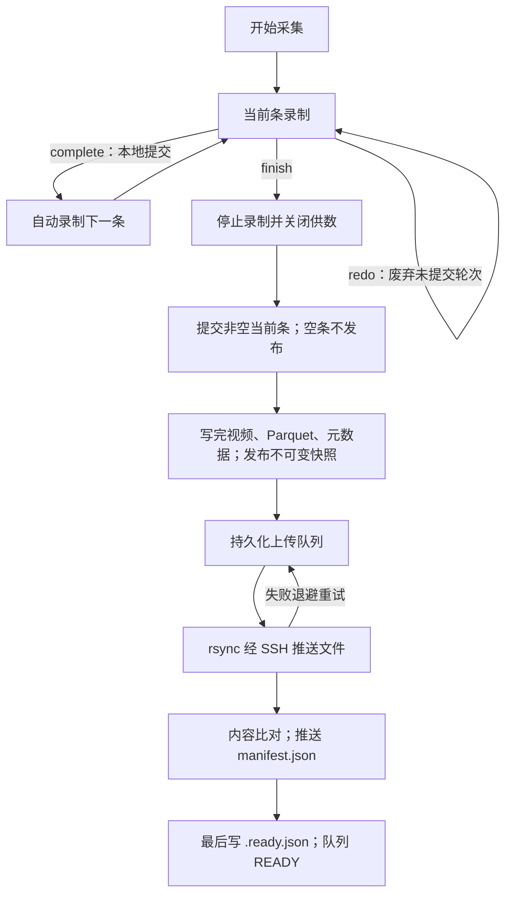

# SO101 采集容器 REST 最小接入指南 — v10r15r1

整理与验证日期：2026-11-04（America/Los_Angeles）。镜像沿用原标签 `so101-collection:20261105-v10r15r1`；当前 Spark 为 `192.168.0.215`。

本文对应当前实现及完整仿真采集上传实测。旧版 v10r11 指南保留在 `docs/history/`，用于查历史，不能继续作为当前控制职责和部署参数的依据。

## 1. 相对 v10r11，前端需要调整什么

| 项目 | 当前约定 |
|---|---|
| 开始、重采、完成本条、结束、放弃 | 五个 POST 的路径和最小正文不变，仍立即返回 202 |
| 对齐 `/collection/align` | **已移除。前端不再调用，旧对齐脚本也不能继续调用这个接口。** |
| `is_sim` | 已无切换作用；旧客户端传入时被忽略，返回中也不再包含它 |
| 采集目标 | 一台容器绑定一个目标，由 `.env` 的 `COLLECTION_ROBOT=so101-sim\|so101\|bobac3` 决定 |
| 主臂读取 | 独立 `so101-leader` 节点读取 USB、发布 `/so101/action`，采集容器不读主臂 |
| 从臂跟随 | 独立从臂节点执行；仿真节点在 `so101-isaac` 内，采集容器不控制从臂 |
| 开始、结束、放弃的运动含义 | **只改变采集和 Redis 供数，不启动或停止主从臂跟随，不能作为机器人停止接口** |
| 视频 | 8910 的列表、JPEG、JPEG WebSocket 接口保留，仍用 `front` / `wrist` |
| 状态查询 | 保留；v10r15r1 修复了录制中查询状态误走旧版 API 的问题 |

原 v10r11 中“开始后由采集容器驱动从臂”“结束后由采集容器让从臂保持并释放串口”“调用采集对齐接口”等描述，均不再适用。四条控制链路见 [控制链路说明](control-chains-v10r15r1.md)。

## 2. 地址、认证与公共返回

```text
REST: http://192.168.0.215:8910
WS:   ws://192.168.0.215:8910
```

本指南的采集与视频接口免 token，不传 `Authorization`、Cookie、`csrf_token`、`robot_key`。JSON 请求只设置 `Content-Type: application/json`。跨域允许 `GET / POST / OPTIONS`，前端使用 `credentials: "omit"`。`/v2/*` 管理接口及 ROS 内部认证不属于这次免认证范围。

五个 POST 经基本检查并持久化受理后，均返回 **HTTP 202**：

```json
{
  "ok": true,
  "result": {
    "accepted": true,
    "message": "已接收，后台执行中"
  }
}
```

字段含义：

```json
{
  "ok": "boolean。本次请求被接口接受；不是后台执行成功证明。",
  "result": {
    "accepted": "boolean。命令已持久化受理，后台继续执行。",
    "message": "string。受理提示，不是保存或上传进度。"
  }
}
```

**202 不等于录制已开始、重采已完成、数据已保存或远端已收到。** 请求不等待编码、封存和上传。前端不再生成或提交 `request_id`，同一次业务操作不要配置 POST 自动重试；容器会检查状态冲突，但不提供跨网络重试的业务幂等保证。

## 3. 接口总表

| 操作 | 方法与路径 | 最小正文 / 查询 | 成功返回 |
|---|---|---|---|
| 开始采集 | `POST /collection/start` | `{"id":"新的批次ID","name":"任务名称"}` | 202，公共受理返回 |
| 重采本条 | `POST /collection/redo` | `{}` 或空正文 | 202，公共受理返回 |
| 完成本条并继续 | `POST /collection/complete` | `{}` 或空正文 | 202，公共受理返回 |
| 结束并封存上传 | `POST /collection/finish` | `{}` 或空正文 | 202，公共受理返回 |
| 放弃当前批次 | `POST /collection/abandon` | `{}` 或空正文 | 202，公共受理返回 |
| 当前采集状态，可选诊断 | `GET /collection/status` | 无 | 200，当前状态 |
| 指定批次状态，可选诊断 | `GET /collection/status?session_id=<开始时的id>` | `session_id` | 200，该批次状态 |
| 画面列表 | `GET /collection/video` | 无 | 200，来源与两路画面状态 |
| 单帧 JPEG | `GET /collection/video/front.jpg`、`wrist.jpg` | 无 | 200，JPEG 字节 |
| 视频 WS | `GET /collection/video/ws?camera=front&fps=10` | `camera`、`fps` 可选 | WS 文本消息 + 二进制 JPEG |

前端无需提交 `project / robot_id / robot_revision / session_id / episode_id / recording_generation / workspace_confirmed / calibration_revision / scene_id / scene_revision`。开始时的 `id` 是上游批次标识，和“前端不用管理内部会话 ID”不矛盾：容器内部直接用这个 `id` 作为本批会话及数据集 ID。

## 4. 开始采集

```http
POST /collection/start
Content-Type: application/json

{
  "id": "dataset-20261104-001",
  "name": "将试管放入试管架"
}
```

请求参数含义：

```json
{
  "id": "string，必填。上游生成的批次唯一标识，也是数据集 ID 和远端文件夹名；1～128 位 ASCII 字母、数字、下划线、点或短横线，以字母或数字开头。每个 id 只能使用一次。",
  "name": "string，必填。非空任务名称/任务文本；对应页面的任务名称。",
  "description": "string，可选。任务描述，可以为空；对应页面的任务描述。",
  "fps": "integer，可选，1～30。请求的录制采样频率，不是机器人速度或视频推流频率；实际速度还受源数据频率与配对条件限制。当前 Spark 配置为 2。",
  "ros": "object，可选。已有登记 ROS 公开配置的相同子集；不能借此改 Topic、QoS、设备或提交密钥，一般省略。"
}
```

返回 **HTTP 202**，正文完整结构见第 2 节。开始后后台打开 Redis 的 `collection_enabled` 供数开关、清理旧积压并录制。SO101 观测来自 Perceptor，action 来自主臂节点；采集容器不负责连接或启动这两个生产方。

可用但不建议继续发送的兼容字段 `is_sim` 会被忽略；不能靠它把当前仿真容器切成真机。不要加入 `request_id`：这会进入旧版兼容通道，和本指南的当前接口不是同一套调用约定。

相同 `id` 再次开始会返回 409 `ID_ALREADY_USED`。受理前参数错误或 BUSY 不占用 id；已返回 202 后后台启动失败，该 id 仍已占用，下一批换新 id。

## 5. 重采本条

```http
POST /collection/redo
Content-Type: application/json

{}
```

没有业务参数，不传 `id`、`session_id`、`episode_id` 或代数。返回 **HTTP 202**，正文完整结构见第 2 节。

后台停止当前录制轮次、废弃当前未提交内容，并开始录制**同一逻辑条序号**。本批 id 不变，内部 `episode_id` 换新、代数增加。已经完成的条目不受影响；被重采的旧轮次不会进入最终数据集。

这不是回退到上一条，也不是完成后开始下一条。条目序号和物理文件编号由后端维护；前端不用计算索引或覆盖 metadata。

## 6. 完成本条并继续

```http
POST /collection/complete
Content-Type: application/json

{}
```

没有业务参数。返回 **HTTP 202**，正文完整结构见第 2 节。

后台提交当前非空条目，成功后自动开始下一条；内部 `episode_index` 增加、`episode_id` 换新。**这一步只本地保存，不上传整批。** 不用另外调用“开始下一条”。如果当前条为空或状态不允许，会拒绝或记录后台失败，不会伪造一条成功数据。

## 7. 结束、封存与自动上传

```http
POST /collection/finish
Content-Type: application/json

{}
```

没有必填参数。返回 **HTTP 202**，正文完整结构见第 2 节。页面的“结束采集”使用这个接口。

后台流程：



结束时不判断“抓取任务有没有做完”。操作者提前点击结束，后台也会保存当时已录制的非空条；完整性检查验证的是文件、格式、计数及数据契约，不能判断任务语义是否成功。不想保存当前条时用重采；想放弃整个未结束批次时用第 8 节。

上传服务器 IP、端口、账号和凭据来自部署配置。默认目录：

```text
<COLLECTION_SYNC_DEPLOY_ROOT>/action-composer/data/artifacts/data_set/<id>/
```

当前实际配置为 `192.168.1.16`，根目录 `/home/lxk/dev2`。前端一般不传上传目标。可选参数：

```json
{
  "upload_url": "string，可选。历史字段名，实际表示已配置同步服务器上的绝对目录，例如 /home/lxk/dev2/action-composer/data/artifacts/data_set；不是 http:// 地址、IP 或 SSH 登录信息。省略、null 或空字符串使用默认目录。"
}
```

传入 `upload_url` 时，结果仍写入 `<upload_url>/<id>/`。目录段只允许字母、数字、`_ + . -`，不能以点或短横线开头，不允许空白、`..` 或根目录 `/`。容器只自动创建目标路径缺失的最后一级，其上级须已经存在且同步账号可写。

上传队列持久化在 `/data/rsync-uploads/`，每台容器同时上传一批，支持断点续传。断网、认证、路径或校验失败进入 `TRANSFER_RETRY` 并退避重试，最长退避 120 秒；容器重启后继续处理。当前版本不调用平台的上传完成回调；以远端 `.ready.json` 为发布完成标记。本地数据不会自动删除。

### 7.1 封存完成和上传完成是两件事

| 状态/标记 | 含义 |
|---|---|
| HTTP 202 | 结束命令已受理 |
| `FINISHING` | 后台停止、提交或封存进行中 |
| `finish_state: QUEUED_UPLOAD`、`finished: true` | 本地结束已完成并进入上传队列；**不表示远端已收到** |
| 采集状态 `IDLE` | 当前可接受新的采集；上一批可能仍在后台上传 |
| 上传队列 `READY` + 远端 `<id>/.ready.json` | 文件已推送、比对完成，并写入完成标记 |

新前端不需要调用旧的 `/collection/operations/{operation_id}`。五个最小 POST 不返回可供它查询的操作 ID；如果需要显示上传完成，应由接收端/平台读取该批 `.ready.json`，而不能把 202 或 `finished: true` 当成 READY。

### 7.2 远端数据形态

上传的是 **LeRobot 目录，不是 ZIP、hash.zip 或单个 payload.bin**：

```text
<id>/
├── manifest.json
├── .ready.json                  # 传输完成标记，最后写入
├── data/chunk-000/file-000.parquet
├── videos/
│   ├── observation.images.front/chunk-000/file-000.mp4
│   └── observation.images.wrist/chunk-000/file-000.mp4
└── meta/
    ├── info.json
    ├── stats.json
    ├── tasks.parquet
    ├── episodes/chunk-000/file-000.parquet
    ├── collection-source.json
    ├── frame-index.jsonl
    └── source-frames/episode-000000/frame-00000000.json ...
```

`.ready.json` 示例（本轮真实结果）：

```json
{
  "schema": "so101.collection-sync.v1",
  "id": "sim-full-v15r1-2181e3f95538",
  "folder": "sim-full-v15r1-2181e3f95538",
  "format": "lerobot_v3",
  "content_hash": "sha256:3ea795ed0d84b9779dd652964707ff850e9245a3e3be70274381fe1198c8ac5a",
  "manifest_sha256": "851f15b2eaa9e4d5f093df70df466030e554027d536138d7601232dbe49e0a69",
  "file_count": 28,
  "total_bytes": 1102442,
  "completed_at": "2026-11-05T06:29:51Z"
}
```

字段含义：`content_hash` 绑定数据集清单内容；`manifest_sha256` 是 manifest 文件字节 hash（没有 `sha256:` 前缀）；`file_count / total_bytes` 包括 manifest、排除完成标记本身；`completed_at` 是标记内容生成的 UTC 时间，不是采集时间或平台入库确认时间。只有它实际出现在远端，才能视为本协议传输完成。

`.ready.json` 是传输附加文件，不在 LeRobot manifest 清单内。消费端做 SDK 严格 inventory 校验时，应在校验视图或工作副本中排除它；不要修改原 manifest 来把它算进去。下一批使用新的 id 和目录，不会写入已封存批次。

## 8. 放弃当前未结束批次

```http
POST /collection/abandon
Content-Type: application/json

{}
```

不接受业务参数。返回 **HTTP 202**，正文完整结构见第 2 节。

取消当前批次及待执行命令，关闭其供数并释放采集占用；未结束批次标为 `ABANDONED`，不上传。本地已保存数据保留；之前已经结束、正在上传的批次不受影响。**它不会停止独立从臂节点的跟随。**

## 9. 可选状态查询

```http
GET /collection/status
```

无需任何查询参数，查询当前容器绑定目标的采集工作状态，而非整台 Spark 的服务总状态。内部是否允许重采、完成和结束，由容器自行判断；前端不必先查询才能提交这些操作。查询可用于界面进度、诊断和确认后台结果。

录制中 HTTP 200 示例：

```json
{
  "ok": true,
  "result": {
    "session_id": "sim-full-v15r1-2181e3f95538",
    "dataset_id": "sim-full-v15r1-2181e3f95538",
    "robot_id": "so101-sim-capture",
    "robot_revision": "redis-0f2a2a769204",
    "target_type": "physical",
    "operator": "operator",
    "episode_id": "96df3ea628fa4f729920c06fecbf032a",
    "episode_index": 0,
    "state": "RUNNING",
    "current_frames": 9,
    "committed_episodes": 0,
    "manual_connection_required": false,
    "notice": null
  }
}
```

返回字段含义：

```json
{
  "session_id": "string。内部会话身份；本接口中等于开始传入的 id，后续控制请求不用带。",
  "dataset_id": "string。数据集批次身份，等于开始传入的 id。",
  "robot_id": "string。容器实际绑定的数据源逻辑身份，不是串口或 IP。",
  "robot_revision": "string。已登记的数据源配置修订。",
  "target_type": "string。适配器内部分类；当前 Redis 仿真源也返回 physical，不能用它判断是否真实从臂。",
  "operator": "string。部署绑定的操作者。",
  "episode_id": "string。当前录制轮次身份；重采与完成换条后改变，仅用于诊断。",
  "episode_index": "integer。从 0 开始的当前逻辑条序号；不是物理文件编号或已完成条数。",
  "state": "string。RUNNING 表示录制中；PROCESSING/FINISHING 表示后台处理；IDLE 表示当前空闲；START_FAILED/NEEDS_RECONCILE 等表示失败或待处理。",
  "current_frames": "integer。当前轮次已记录帧数；不是全批帧数，重采后重新计算。",
  "committed_episodes": "integer。当前批次已本地提交条数；不表示已上传。",
  "manual_connection_required": "boolean。是否提示手动连接输入；false 不替代上游数据实际可用性检查。",
  "notice": "string|null。提示信息。"
}
```

空闲时通常只返回 `state / robot_id / robot_revision / target_type`，不要要求每个状态都有录制字段。当前仿真/真机选择以部署的 `COLLECTION_ROBOT` 为准，不能使用上面已说明的 `target_type` 代替它。

如需查询本批历史结束结果，使用开始时已经保存的 id：

```http
GET /collection/status?session_id=sim-full-v15r1-2181e3f95538
```

本轮结束后的实际 HTTP 200 返回：

```json
{
  "ok": true,
  "result": {
    "session_id": "sim-full-v15r1-2181e3f95538",
    "dataset_id": "sim-full-v15r1-2181e3f95538",
    "robot_id": "so101-sim-capture",
    "robot_revision": "redis-0f2a2a769204",
    "target_type": "physical",
    "episode_id": "b603ce52721b44ce973f875f03f6aa7a",
    "episode_index": 2,
    "state": "IDLE",
    "active": false,
    "finish_state": "QUEUED_UPLOAD",
    "finished": true,
    "automatic_upload": true,
    "upload_operation": "04d1cb04ce4c49329ebf2be8c3d3bf26"
  }
}
```

这里 `active:false` 表示该批已不在录制；`finished:true` 表示本地结束已完成；`automatic_upload:true` 表示已交给后台上传；`upload_operation` 是内部关联标识，不应拿它调用旧版通用操作查询。结束后条目字段可能指向下一条空占位；最终有效条数看已封存 manifest 的 `episodes`，本例是 2。

## 10. 视频接入

```text
列表：http://192.168.0.215:8910/collection/video
前方 JPEG：http://192.168.0.215:8910/collection/video/front.jpg
腕部 JPEG：http://192.168.0.215:8910/collection/video/wrist.jpg
前方 WS：ws://192.168.0.215:8910/collection/video/ws?camera=front&fps=10
腕部 WS：ws://192.168.0.215:8910/collection/video/ws?camera=wrist&fps=10
```

`camera` 可选，默认 `wrist`，仅允许 `front / wrist`；`fps` 可选，默认 10，范围 1～30，是推流上限，不保证源画面有这么高的帧率，也不影响录制 fps。最多同时 16 路连接。

WS 是 **JPEG over WebSocket，不是 WebRTC 信令**。连接后客户端无需先发消息，不传 SDP、robot_key、token。服务端先发文本 JSON：

```json
{
  "type": "hello",
  "source": "sim",
  "camera": "front",
  "fps": 10,
  "fresh": true,
  "width": 640,
  "height": 480,
  "format": "image/jpeg"
}
```

之后每条二进制消息就是一帧 JPEG。来源为 `sim` 或 `real`，由部署配置确定；连接 A 在 URL 选择 front，连接 B 选择 wrist，即可分别绑定两个显示区域。`fresh` 表示有新鲜画面，宽高单位为像素；暂时没画面时宽高可能为 null，后续 `type:status` 文本消息更新 `fresh`；参数错误或连接过多时发送 `type:error` 后关闭。断线后重连。

JPEG 响应还带 `X-Frame-Sequence / X-Captured-Unix-Ns / X-Video-Source`。训练用原始帧和来源时间戳由采集数据链路保存，不能用浏览器 JPEG 到达时间替代它。

## 11. 失败与前端处理

立即拒绝时返回非 202，例如：

```json
{
  "ok": false,
  "error": {
    "code": "BUSY",
    "message": "End the current collection before starting another"
  }
}
```

常见错误：400 `INVALID_FIELDS / INVALID_ID / INVALID_NAME / INVALID_UPLOAD_URL`；409 `BUSY / ID_ALREADY_USED / NO_CURRENT_COLLECTION / NOT_RECORDING`。202 后的后台失败不能从最初的 HTTP 回复判断，需结合当前状态或接收端完成标记。连接失败、超时不一定是 HTTP 500；不要据此自动重发重采、完成等控制命令。

旧的 `project`、`request_id`、会话路径式接口属于兼容入口；本指南的新前端只用第 3 节最小接口，不混用兼容参数。8920 是旧测试工作台，不作为当前外部接入依据。

## 12. 本次完整链路验收

实测批次：`sim-full-v15r1-2181e3f95538`。使用当前运行容器和现有上传配置，没有换成内存假数据或本机复制来代替上传。

| 步骤 | 结果 |
|---|---|
| 开始 | POST 202；进入 RUNNING、供数开启 |
| 重采本条 | POST 202；逻辑条仍为 0，内部轮次 ID 改变，废弃的原始帧被移除 |
| 完成本条 | POST 202；提交第一条并自动录制第二条；此时没有上传任务 |
| 结束 | POST 202；保存第二条、关闭供数、释放采集占用，恢复 IDLE |
| 封存 | LeRobot V3；2 条、18 帧，长度分别为 10 / 8；两路 640×480 RGB；MP4、Parquet、metadata 原生校验通过 |
| 来源与配对 | 36 条相机帧索引，18 条来源记录；主臂 action 配对差 0.3～31.0 ms；废弃轮次不在最终数据中 |
| 上传 | 实际 rsync over SSH 到 192.168.1.16；第 1 次尝试 READY |
| 远端核对 | 28 个封存文件全部逐字节 SHA256/大小一致；另有最后写入的 `.ready.json`，共 29 文件 |
| 请求耗时 | Spark 本机调用的四个 POST 约 5.9～13.1 ms，未等待后台完成；不是远端浏览器延迟承诺 |
| 服务 | 采集、主臂、Isaac 容器 ID 和启动时间保持一致；真实从臂控制器未启动 |

本地封存数据宿主机路径：

```text
/home/nvidia/so101-collection/data/collection-snapshots/sim-full-v15r1-2181e3f95538/b45f8a4f64664cdbb1b8adcd8cdc4451-g1/
```

远端（192.168.1.16）目录：

```text
/home/lxk/dev2/action-composer/data/artifacts/data_set/sim-full-v15r1-2181e3f95538/
```

完整测试记录在 Spark `/home/nvidia/lerobot-so101-sdk/sim-chain-full-v15r1/`；不含凭据的摘要见 [验收摘要](sim-chain-full-v15r1-acceptance.json)。

验收证明当前仿真采集、重采、换条、封存和上传工程链路可用。没有验证真实从臂、完整人工动态示教精度或抓取效果。主臂目标超过 Isaac 关节范围时仍会裁剪，action 记录主臂意图，不等同于从臂真实下发回执；这项限制没有因本次上传验收而消失。
