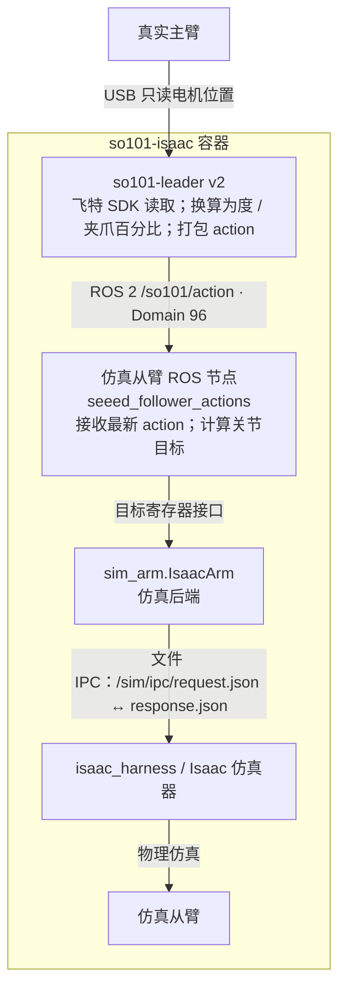
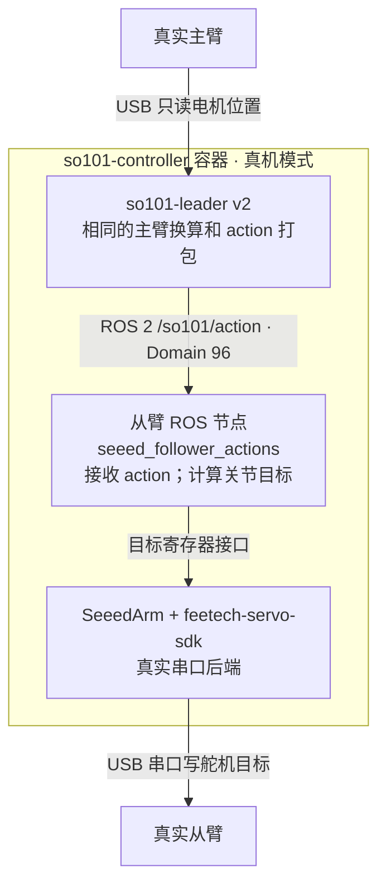
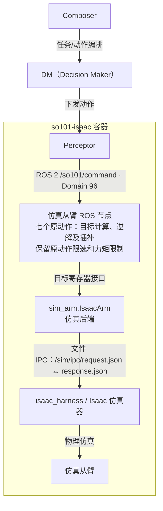
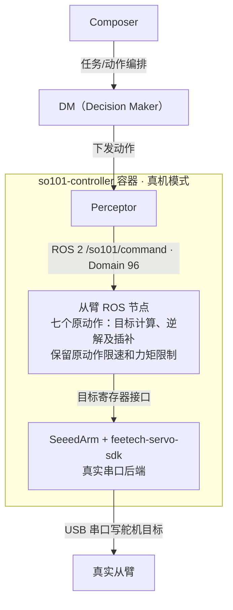

# SO101 四条控制链路与仿真验收（v10r15r1）

验证日期：2026-11-04（America/Los_Angeles）。组件镜像沿用原有标签中的日期。

本文给出四条修改后的控制链路：两个主臂跟随链路、两个原动作链路。图中“仿真从臂 ROS 节点”是控制逻辑，已经并入 `so101-isaac`，不是另一个正在运行的 `so101-controller` 容器。采集容器不在这四条运动控制路径中。

本轮实际上线：采集容器 `so101-collection:20261105-v10r15r1`；主臂 `so101-leader:20261104-v2`；Isaac 内节点使用已测控制器镜像 `f009d77c0883` 中的源代码。真实从臂的 `so101-controller` 保持停止，没有替换或启动。

原 v15 镜像 `0fd7f65bcd52` 保留。本轮发现并修复了无参数 `/collection/status` 错走 v9 服务的问题，另建 v15r1；补丁只改采集 HTTP 状态路由和回归测试，主臂与从臂镜像不变。

## 与旧链路的区别

| 项目 | 修改后 |
|---|---|
| 主臂读取 | 从 `so101-collection` 移到独立 `so101-leader` 节点；主臂只读，不写舵机 |
| 主臂 action | 主臂节点先打包 `teleop/action/v1`，再发布 ROS；供数开着时同一 JSON 进入 Redis |
| 仿真跟随/原动作 | 控制逻辑在 `so101-isaac` 内，通过文件 IPC 调用仿真器 |
| 真实从臂 | 目标架构仍由独立 `so101-controller` 写 USB 串口；本轮未部署 |
| 采集 | 只从 Redis 取 observation/action、配对、录制与封存；不读主臂、不控制从臂 |
| 对齐 | 由操作者负责；v15 不提供 `/collection/align` |

## 链路 1：真实主臂 → 仿真从臂

**已上线；本轮跟随及采集实测。**



## 链路 2：真实主臂 → 真实从臂

**目标版本已构建；本轮未部署、未真机实测。**



## 链路 3：Composer / DM / Perceptor → 仿真从臂

**仿真节点已上线；ROS 命令/回执可用，未从 Composer 界面全链触发。**



动作回执经 `/so101/result` 返回 Perceptor，再由上层处理。只画向下执行路径，不表示上层调用的全链路已在本轮逐项触发。

## 链路 4：Composer / DM / Perceptor → 真实从臂

**目标版本已构建；本轮未部署、未真机实测。**



动作回执经 `/so101/result` 返回 Perceptor，再由上层处理。只画向下执行路径，不表示上层调用的全链路已在本轮逐项触发。

## 共用的数据采集旁路

这部分是四条控制链路之外的数据通路，不参与运动控制：

| 数据 | 生产方 | 传输/存储 | 消费方 |
|---|---|---|---|
| 主臂 action | `so101-leader` | ROS `/so101/action` 常发；开关为 1 时另外 LPUSH `collection_action_queue` | 从臂节点接 ROS；采集容器消费 Redis |
| 从臂状态与图像 | Perceptor | `collection_observation_queue`；图片字节另存 Redis key | 采集容器 BRPOP 后立即取出图片 |
| 状态推送 | 从臂节点 | `/so101/state` | 可供订阅；本轮 ROS 图中没有 Perceptor 订阅者，当前 Perceptor 仍走 `ARM_INSPECT` 取状态 |
| 实时图像 | 采集容器的相机/仿真预览入口 | `8910/collection/video/front.jpg`、`wrist.jpg` | Perceptor 获取图像帧 |
| 录制数据 | 采集容器 | 持久化 RGB/来源 NPZ，再输出 LeRobot MP4、Parquet、meta/frame-index.jsonl | 后续训练或同步 |

采集开始会自行 `SET collection_enabled 1 NX`；完成整批/放弃/关闭会话时释放开关。本轮只用 `abandon`，没有调用 `finish`。关闭供数不停止主臂 ROS 发布，因此不停止主从跟随。停止之后 Redis 可能留少量尾部消息，下次开始按现有规则清积压；不承诺所有相机源帧都被录制。

SO101 按 `sources.arm_state.sampled_at` 找第一条时间不早于它的主臂 action，配对上限为 0.1 秒。帧里保存动作 ID、主臂序号和时间差。此规则是 v15 的动作配对规则，不是新增图像时间戳校验；图像的原始时间和时间基准继续保留。

## 本轮实测

| 项目 | 结果 |
|---|---|
| ROS `/so101/action` | 约 30.58 Hz；唯一发布节点 `so101_leader`，订阅节点 `seeed_follower_actions` |
| ROS `/so101/state` | 约 4.98 Hz |
| 从臂跟随 | `native.follow.enabled=true`、`following=true`；动作进程来自真实 USB 主臂节点 |
| 实际短采集批次 | `v15r1-sim-e2e-20261104-82a1c4e5` |
| 原始录制帧 | 10 帧，front/wrist 两路均为 640×480 |
| action/observation | 每帧验证主臂 action 数值及“观测状态之后第一条 action”；配对差 0.0011～0.0329 秒 |
| 收尾 | `abandon` 后批次为 `ABANDONED`，接口回 `IDLE`，供数开关已删除 |
| 上传 | 本批次同步任务数 0；未调用 finish、未请求上传 |
| 真机 | 只读真实主臂；真实从臂 controller 未启动 |

主臂节点复测 15/15，控制器复测 127/127（`SO101_DIRECT_CONTROL=0`，只适用于旧租约测试环境）。采集原版相关用例分批验证：46 项通过；37 项因测试容器缺少可写 `/data` 的环境错误，补齐私有 tmpfs 后 37 项通过。状态补丁新增 5 项回归先失败再通过；新接口 6 项通过。补丁扩展批量测试中另有一个未改动的“取消待启动批次”用例超时，该用例在原镜像与补丁镜像独立复测均通过，日志保留；不是宣称重新单次跑了全部 417 项。

本轮第一次现场采集实际写入了数据，但无参数状态查询返回 `API_VERSION_MISMATCH`，已用放弃收尾。根因为 GET 走旧 v9、POST start 走 v10。v15r1 改为优先 v10，仅遇版本不匹配时兼容 v9；权限错误不降级。上表为补丁后的现场复验。

## 跟随与原动作的关系

- 跟随路径按现有版本不额外限速/限加速度，保留底层关节范围裁剪；最长每 0.05 秒下发最新目标。0.5 秒没有新 action 后不再更新目标，保留最后目标。
- **七个原动作的限速和力矩限制保留。** 执行原动作时暂停跟随，动作开始前恢复原动作自己的参数；原动作结束后持续的主臂 action 会恢复跟随，可能覆盖原动作最终姿态和夹爪状态。
- 本轮采集期间没有混入七个原动作。数据集 action 表示主臂指令，`action.executed` 当前也复制此值，并非每帧从臂执行回执；不能据此宣称从臂到位、真实执行目标或抓取成功。
- `native.phase` 是原动作/通电保持的通用字段，跟随时也可能显示 HOLDING；跟随是否生效看 `native.follow.following`、`action_seq` 和 `action_age_s`。
- 四条图是两种控制方式、两种从臂后端的分支，不是让真机和仿真控制节点同时监听同一组话题。真机分支尚未部署；未来切换需单独交接节点、匹配 robot_type 和配置。

## 验收范围与已知边界

本轮验证真实主臂当前姿态到仿真从臂的跟随接口、Redis 供数、录制与配对，以及放弃收尾；没有人工全行程拖动、动态跟随精度或真实从臂运动验收。上层 Composer→DM→Perceptor 按现有代码/ROS 图确认结构，本轮没有从 Composer 界面逐个触发七动作。

**当前姿态存在范围裁剪，不能理解成一比一到位。** 实测主臂肩部目标约 -103.78°，低于 Isaac 的 -100°；肘部约 96.92°，高于 Isaac 的 90°。`sim_arm` 会按仿真范围裁剪，实际观测约 -99.78° / 89.23°。本轮没有放宽仿真关节范围。采集 action 保留主臂指令，所以它与仿真实际下发值可能不同。

本轮实际批次使用放弃收尾，只验证了持久化原始帧与配对，未将该批次封存成最终 LeRobot 目录；原生格式封装由隔离环境中的相关测试覆盖。若录制期间同时执行七个原动作，主臂指令不一定是当时真正驱动从臂的指令，需由后续采集模式/业务互斥明确；本轮没有混用两种控制入口。

Perceptor 状态源约 2 Hz，状态时刻是近似计算值；主臂 30 Hz 并不把观测变成 30 Hz，也不代表硬件同步。原始时刻已保留。当前 Redis 适配器在 API 中使用 `target_type=physical`，这是该适配器的内部分类；本轮真实运动后端以 `robot_id=so101-follower-isaac`、`SO101_BACKEND=isaac` 和节点所在容器为准，不能将这个 API 标签当作真机验收证据。

## 当前文件位置

| 内容 | 位置 |
|---|---|
| 当前采集版本、Compose、.env | `/home/nvidia/lerobot-so101-sdk/collection-container-v10r15r1-20261105/` |
| 原 v15（保留） | `/home/nvidia/lerobot-so101-sdk/collection-container-v10r15-20261105/` |
| 主臂部署目录 | `/home/nvidia/so101-leader/` |
| Isaac 内从臂代码（宿主机） | `/home/nvidia/so101-collection/data/isaac-console/follower/` |
| Isaac 内从臂代码（容器内） | `/sim/follower/` |
| 真机控制器目标源码 | `/home/nvidia/lerobot-so101-sdk/so101-controller-state-push-20261104/`；真实运行容器保持停止 |
| 测试、配对证据、备份 | `/home/nvidia/lerobot-so101-sdk/teleop-v15-acceptance/` |

## 只读检查

```bash
curl -s http://127.0.0.1:8910/collection/status
docker exec redis redis-cli GET collection_enabled
docker exec so101-isaac /sim/follower/run.sh inspect
docker exec so101-leader /opt/so101/leader/entry.sh ros topic echo /so101/action --once
```

如需重做采集，用全新的上游 id 调用 `/collection/start`，最后调用空参数 `/collection/abandon`。本轮没有删除既有数据，也没有上传验收批次。
